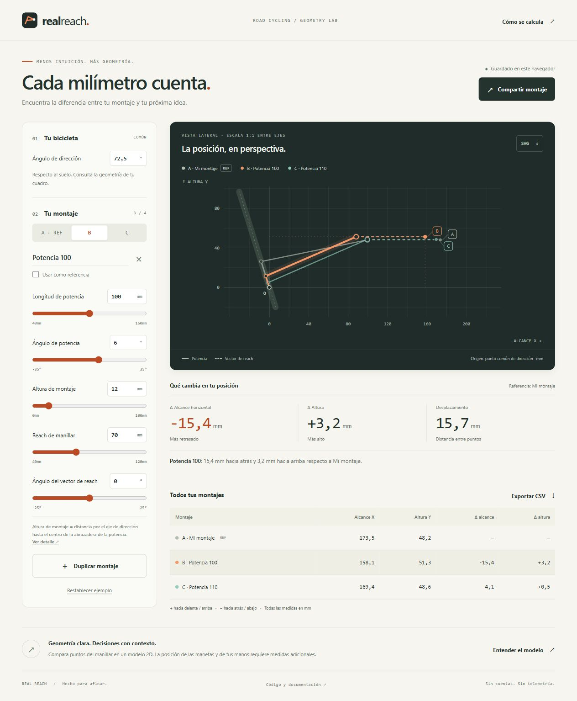

<p align="center"></p>

<h1 align="center">Real Reach</h1>
<p align="center"><strong>Cada milímetro cuenta.</strong><br>Compara potencia y manillar. Entiende cuánto cambia tu posición.</p>
<p align="center">JavaScript nativo · Sin dependencias web · Geometría 2D · Versión Python incluida</p>



Una potencia más corta no siempre desplaza el manillar lo que esperas. El ángulo de dirección, la inclinación de la potencia y la altura de montaje también intervienen. **Real Reach visualiza esa combinación** y calcula las diferencias respecto a un montaje de referencia.

El proyecto nació como un pequeño comparador en Python y Matplotlib. La versión web conserva su modelo geométrico y permite explorar los cambios sin editar código.

## Empezar

No hay compilación, cuentas ni paquetes de JavaScript que instalar. Desde la raíz del repositorio, con Python 3.10 o posterior:

```sh
python -m http.server 8000 --bind 127.0.0.1
```

Abre **[localhost:8000](http://localhost:8000)** en un navegador moderno. En Windows puedes usar `py` en lugar de `python`. También sirve cualquier servidor de archivos estáticos. No abras `index.html` con doble clic: los módulos JavaScript necesitan HTTP.

### Tu primera comparación

1. Introduce el **ángulo de dirección** del cuadro, medido respecto al suelo.
2. Selecciona A, B o C y ajusta las medidas con los deslizadores o los campos numéricos.
3. Marca **Usar como referencia** en el montaje que quieras mantener como punto de comparación.
4. Lee las diferencias: **ΔX positivo = hacia delante; ΔY positivo = hacia arriba**.
5. Duplica un montaje para explorar otra opción. Puedes comparar hasta cuatro.

Los resultados se actualizan al cambiar un valor válido. Un campo vacío o fuera de rango muestra un aviso; el diagrama conserva el último cálculo válido y se desactiva la exportación hasta corregirlo.

## Qué puedes hacer

- Comparar hasta cuatro montajes con un origen y ángulo de dirección comunes.
- Ver dirección, potencia y vector de reach en un SVG con la misma escala en ambos ejes.
- Cambiar la referencia sin reintroducir las medidas.
- Consultar alcance, altura y desplazamiento entre puntos, con una cifra decimal.
- Conservar la comparación en el almacenamiento local del navegador.
- Compartir un enlace con los nombres, las medidas y la referencia elegida.
- Exportar todos los resultados en **CSV** o el diagrama en **SVG**.
- Utilizar controles de teclado, etiquetas accesibles, tabla alternativa al gráfico y diseño adaptable.

El enlace compartido conserva la dirección del servidor actual. Para que otra persona pueda abrirlo, usa la aplicación publicada; un enlace a `localhost` solo apunta al ordenador de quien lo abre.

## Qué se está midiendo

El resultado es **un punto geométrico del manillar respecto a un origen común en el eje de dirección**. No es el reach del cuadro ni una medición completa de la posición de las manos.

| Entrada              | Símbolo | Definición                                                                                            | Rango web |
| -------------------- | ------- | ----------------------------------------------------------------------------------------------------- | --------- |
| Ángulo de dirección  | α       | Ángulo de la dirección respecto a la horizontal                                                       | 60–85°    |
| Longitud de potencia | L       | Distancia entre centros de las abrazaderas                                                            | 40–160 mm |
| Ángulo de potencia   | β       | Ángulo nominal respecto a la perpendicular al eje de dirección                                        | −35–35°   |
| Altura de montaje    | h       | Distancia **por el eje de dirección** desde el origen hasta el centro de la abrazadera de la potencia | 0–100 mm  |
| Reach de manillar    | R       | Longitud del vector idealizado de alcance                                                             | 40–120 mm |
| Ángulo del vector    | γ       | Inclinación de ese vector respecto a la horizontal                                                    | −25–25°   |

**h no es simplemente la altura de los espaciadores.** Si eliges como origen la parte superior del cuadro, incluye la tapa de dirección, los espaciadores y la distancia hasta el centro de la abrazadera. Mantén exactamente el mismo origen para todos los montajes. Las alturas de los ejemplos se han conservado del proyecto original y no representan una recomendación de montaje.

Una potencia de 0° es perpendicular al eje de dirección, no paralela al suelo. Por ejemplo, con dirección de 72,5° y potencia de −6°, la inclinación de la potencia respecto al suelo es **11,5°**.

### Fórmulas

Con X positivo hacia delante e Y positivo hacia arriba:

```text
θ = 90° − α + β

X = −h · cos(α) + L · cos(θ) + R · cos(γ)
Y =  h · sin(α) + L · sin(θ) + R · sin(γ)

ΔX = X_montaje − X_referencia
ΔY = Y_montaje − Y_referencia
d  = √(ΔX² + ΔY²)
```

El código convierte los grados a radianes antes de aplicar las funciones trigonométricas. Los cálculos y deltas usan toda la precisión disponible; la interfaz redondea a 0,1 mm y el CSV a 0,001 mm. Esa resolución numérica no implica igual precisión en una bicicleta real.

### Límites del modelo

- Todos los montajes pertenecen al **mismo cuadro y origen**. Para comparar cuadros diferentes faltan sus coordenadas de stack y reach.
- El manillar se aproxima mediante un vector. La caída, la forma de sus curvas y la posición de las manetas quedan fuera.
- γ describe el vector idealizado: rotarlo no reproduce por sí solo la rotación de todos los puntos de un manillar real.
- No se modelan sillín, longitud del ciclista, flexión, tolerancias o cambios bajo carga.
- La herramienta compara geometría; no determina cuál es tu ajuste biomecánico óptimo ni certifica la compatibilidad de componentes.
- Los rangos de entrada delimitan la herramienta. Los límites de espaciadores, apriete y montaje los establece el fabricante.

La [documentación de Ritchey](https://ritcheylogic.com/bike/stems/wcs-c220-84d-stem) muestra la convención 84°/6° para una potencia de ±6°. La [guía de Shimano sobre posición del manillar](https://bike.shimano.com/en-NA/stories/article/road-handlebar-setup.html) explica la influencia independiente de la forma del manillar y las manetas. Estas fuentes aportan contexto de componentes; el modelo vectorial y sus límites se definen arriba.

## Desarrollo y pruebas

Requisitos de desarrollo: **Node.js 22+** y **Python 3.10+**. Las pruebas no necesitan Matplotlib ni paquetes de npm.

```sh
node --test
python -m unittest discover -s tests -p "test_*.py" -v
```

También puedes ejecutar `npm test`. No se necesita `npm install` ni un archivo de bloqueo porque no hay dependencias npm. La integración continua ejecuta ambas suites en cada pull request y push a `main`.

Las pruebas cubren casos geométricos analíticos compartidos entre JavaScript y Python, inversión de referencias, desplazamiento por el eje de dirección, extremos de rango, entradas no finitas, estado externo, enlaces Unicode y protección de celdas CSV frente a fórmulas. La comprobación manual de interfaz está descrita en [CONTRIBUTING.md](CONTRIBUTING.md).

```text
index.html                     Interfaz y explicación accesible del modelo
styles.css                     Diseño adaptable, impresión y foco de teclado
src/
  geometry.js                  Cálculo puro y límites numéricos
  state.js                     Estado validado y enlaces compartibles
  chart.js                     Diagrama SVG
  export.js                    CSV con escape de celdas
  app.js                       Controles, persistencia y experiencia de uso
tests/
  fixtures/geometry.json       Casos analíticos comunes
  geometry.test.js             Pruebas nativas de Node
  test_geometry.py             Pruebas nativas de Python
calculador_potencias/           Versión de escritorio original, conservada
.github/workflows/             Comprobaciones y publicación manual
```

### Versión Python

```sh
python -m pip install -r requirements.txt
python "calculador_potencias/calculadora potencia.py"
```

Edita `configs` en ese script para definir los montajes. Cada tupla contiene:

```python
(longitud_potencia, angulo_potencia, altura_montaje, reach_manillar, angulo_vector)
```

La primera configuración es la referencia. Se mantienen las funciones `calcula_endpoint`, `calcula_deltas` y `dibuja`. `calcula_punto` expone ahora el extremo completo. Las descripciones de `calcula_deltas` se han corregido y están en español; no deben usarse como una API de datos estructurados. La versión Python valida medidas finitas y longitudes físicas básicas, pero no impone los rangos de exploración de la UI.

## Publicar en GitHub Pages

1. Sube estos cambios a tu repositorio.
2. En **Settings → Pages → Build and deployment**, selecciona **GitHub Actions**.
3. En **Actions → Publish to Pages**, ejecuta **Run workflow** sobre `main`.
4. Abre la URL que aparece en el entorno `github-pages` tras finalizar el despliegue.

La publicación es manual. El workflow ejecuta las pruebas y empaqueta solo HTML, CSS, el icono y `src/`; no publica el código Python ni los archivos de pruebas como parte del sitio. Los recursos usan rutas relativas para funcionar bajo el subdirectorio del repositorio. Consulta la [guía oficial de workflows de Pages](https://docs.github.com/en/pages/getting-started-with-github-pages/using-custom-workflows-with-github-pages) para la configuración del servicio.

También se puede desplegar el mismo conjunto de archivos en cualquier alojamiento estático, sin proceso de compilación.

## Datos y privacidad

La aplicación no añade analítica, cookies de seguimiento ni llamadas a servicios externos. Las fuentes y los recursos de la interfaz son locales. Los montajes se guardan en `localStorage` del navegador; borrar los datos del sitio los elimina.

Un enlace compartido incluye **todos los nombres y medidas** dentro de su fragmento `#setup=…`. El fragmento no se envía al servidor como parte de la petición HTTP, pero cualquiera que reciba el enlace puede leerlo. Un enlace recibido sustituye la comparación local; la herramienta no mantiene un historial. El proveedor de alojamiento puede registrar las peticiones habituales del sitio.

Si el almacenamiento está bloqueado, la calculadora sigue funcionando en memoria e indica que no hay guardado local. Si el portapapeles no está disponible, muestra el enlace para copiarlo manualmente.

## Contribuir

Para informar de un fallo, aporta medidas, resultado esperado, resultado observado y navegador. Lee [CONTRIBUTING.md](CONTRIBUTING.md) antes de cambiar el cálculo.

El repositorio no declara actualmente una licencia de distribución. Que el código sea visible no concede por sí solo una licencia de reutilización; corresponde al autor elegirla.
